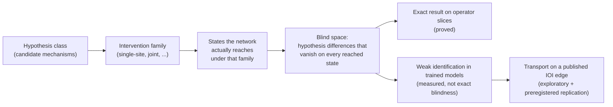
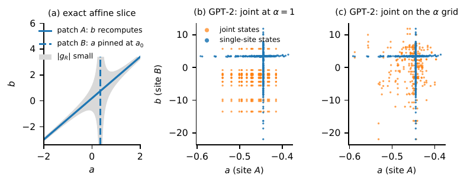
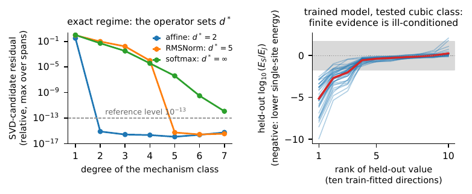
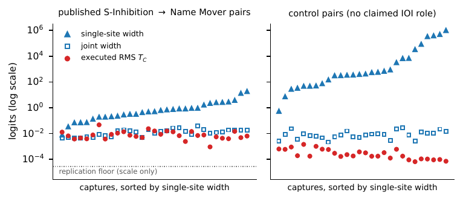
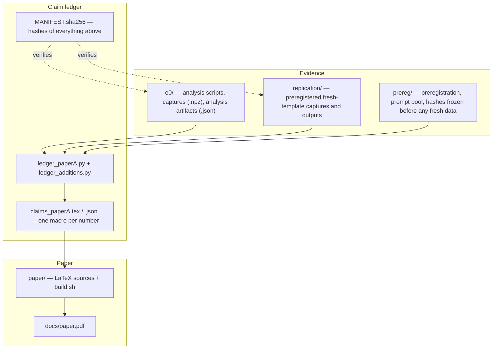

# What Can Activation Patching Actually Establish?

**Reachable-State Geometry and the Limits of Mechanistic Evidence**

Ankush Kadu, Ananth Kalyanasundaram, Aswanth Krishnan — QpiAI, India

[Paper (PDF)](docs/paper.pdf) · arXiv: *link added after posting* · An earlier version was accepted as a poster at the
NeurIPS 2026 Workshop TAE (Trust-AI-Eval); this release accompanies the corrected arXiv version.

This repository holds the code, the data and the **claim ledger** behind the paper: every number in the text is a
LaTeX macro that a script re-derives from hashed artifacts, so you can check any figure or percentage yourself.

---

## The idea in one minute

Activation patching replaces an internal activation, lets the network recompute, and reads the change in behaviour as
evidence for a mechanism ("head X contributes", "A feeds B"). The paper asks a prior question: **which alternative
mechanisms could that experiment have ruled out?**



* The **analyst chooses the intervention, but the network produces the state** — so the blind space can be computed
  without reading any model output.
* On analysed two-site operator slices some hypothesis differences are *exactly* blind. The operator fixes the
  polynomial degree at which this starts: **2** for affine slices, **5** for the stated normalisation slices, and no
  finite degree for the analysed softmax and gated slices.
* In trained transformers the single-site and joint designs have full rank, so the question becomes *how weakly* some
  directions are constrained — not whether they are exactly unidentifiable.

## Figures

### Why single-site patching can leave a direction weakly constrained



*(a)* On an exact affine slice, single-site states lie on the blue arms (site B recomputes, or site A pinned), and the grey
region where the hypothesis difference |g_R| is small contains both. *(b)* One GPT-2 small IOI capture: single-site
states (blue) form thin arms, while joint states (orange) spread across a region. *(c)* Matching the joint family's grid
to the single-site grid broadens its range in this capture. The trained-model arms illustrate weak identification, not
exact vanishing.

### The operator sets the degree; trained models are ill-conditioned, not blind



*Left:* the best polynomial relation fitted on each operator slice reaches numerical precision at the proved degree
(2 for affine, 5 for RMSNorm); the softmax residual keeps decreasing, but residuals alone cannot tell an exact relation
from an accurate approximation. *Right:* in GPT-2 IOI captures, held-out energy along some train-fitted directions is far
lower under single-site than under joint patching (the axis is log10 of the energy ratio, so negative means lower
single-site energy); the grey band is the same-family envelope.

### Width of what single-site evidence can say vs. the effect actually measured



On published S-Inhibition → Name-Mover edges (left) and on control captures (right), per capture: the single-site
working-model identification width (triangles), the joint width (squares) and the RMS of the executed transport
contrast (red circles), on a log scale. The widths are properties of the working model — neither observed errors nor
calibrated bounds. This section is **exploratory** (three base prompts). The preregistered replication met its smallness
criteria but could not compare published with control heads, because most control contrasts sat at the float32 floor, so
the paper reports no published/control ratio and makes no above-control claim. The dotted line is a scale reference only.

## What is claimed, and with what status

| Claim | Status |
|---|---|
| Exact blind space and degree on the analysed operator slices | proved (theorems in the paper) |
| Trained-model designs are full rank; direction weakly constrained | measured on the tested charts and classes |
| Held-out energy ≥ 10× smaller under single-site than joint in 171/185 captures (10 model–task cells) | measured, re-derived by the ledger |
| Two comparison pitfalls between intervention families; the claims they produced are withdrawn | reported, with corrections |
| IOI transport deviation small on the tested grids | exploratory (3 base prompts) + preregistered replication (24 prompts, 8 templates): H1 passed, H2 floor-limited |

The earlier workshop version contained errors; all 57 corrections are listed with sources in
[`CORRECTIONS_LEDGER.md`](CORRECTIONS_LEDGER.md) and in Appendix A of the paper.

## Quick start: check the numbers yourself (CPU only, no GPU)

```bash
git clone https://github.com/Ankush-kadu/activation-patching-reachable-state-geometry.git
cd activation-patching-reachable-state-geometry
python3 -m venv .venv && source .venv/bin/activate
pip install -r requirements.txt

sha256sum -c MANIFEST.sha256          # every script and data file is unchanged
python3 ledger_paperA.py --verify     # re-derive every number in the paper; fails on any drift
```

Rebuild the paper from the ledger output (needs `pdflatex`, `bibtex`):

```bash
(cd paper && E0_DIR=../e0 ./build.sh)
```

`tools/clean_checkout_gate.sh <dir>` runs all checks in a fresh copy and also re-runs the registered replication
analysis from the released captures. Re-collecting the captures needs a GPU and GPT-2 small; see
[`docs/REPRODUCTION_DETAILS.md`](docs/REPRODUCTION_DETAILS.md).

## Repository map



| Path | Contents |
|---|---|
| `e0/` | analysis, capture and figure-data scripts; intervention captures and the artifacts every number derives from |
| `replication/`, `prereg/` | preregistered replication: protocol, frozen hashes, 576 fresh captures, registered outputs |
| `ledger_paperA.py`, `claims_paperA.*` | the claim ledger and its output |
| `corrections_ledger.json`, `CORRECTIONS_LEDGER.md` | the 57 corrections to the earlier version |
| `paper/` | manuscript sources and `build.sh` |
| `tools/` | manifest, release and verification scripts |

## Citation

```bibtex
@misc{kadu2026patching,
  title  = {What Can Activation Patching Actually Establish? Reachable-State Geometry and the Limits of Mechanistic Evidence},
  author = {Kadu, Ankush and Kalyanasundaram, Ananth and Krishnan, Aswanth},
  year   = {2026},
  note   = {arXiv link added after posting}
}
```

Code and data: see the licence note below. The paper text is © the authors.

## Licence

Code: MIT. Data and captures: CC BY 4.0.
